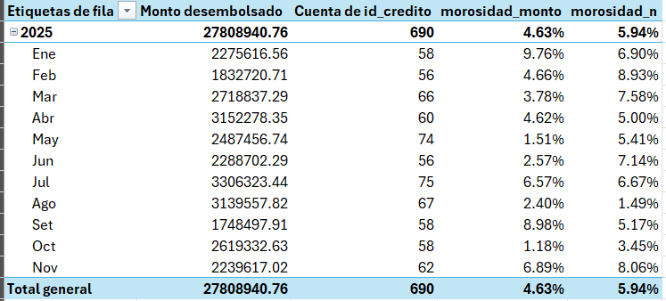
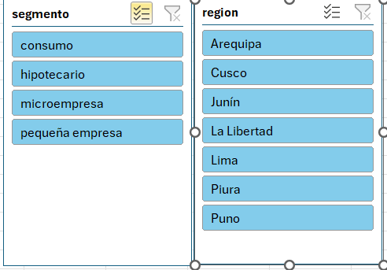
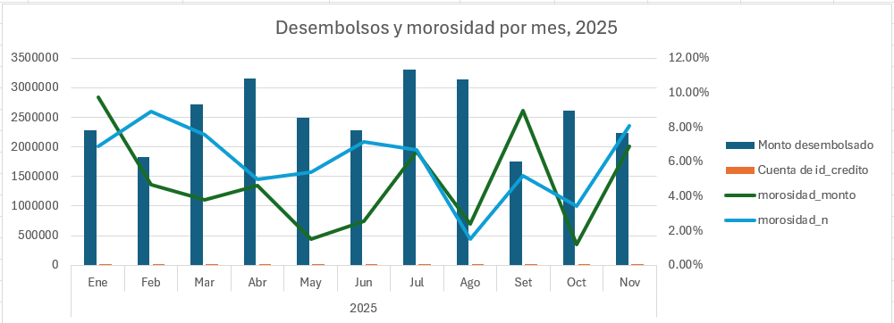

# Análisis de morosidad de cartera de créditos (Excel + Power Query)

Proyecto personal de práctica: consolida y limpia varias fuentes de desembolsos de créditos y calcula indicadores de morosidad en un tablero de Excel que se actualiza con un clic.

> **Los datos son simulados.** Se generaron con fines de práctica y no corresponden a ninguna entidad financiera real.

### Tabla dinámica


### Segmentadores


### Gráfico


## Qué hace

- Consolida **4 archivos CSV** de desembolsos (ene-mar, abr-jun, jul-sep y oct-nov de 2025) en una sola tabla de **690 créditos**.
- Limpia los datos con **Power Query**, sin tocar los archivos originales.
- Calcula la morosidad (mora > 90 días) **por monto** y **por número de créditos**.
- Presenta los resultados en una **tabla dinámica** con segmentadores por segmento y región, y un gráfico combinado (monto en columnas, morosidad en líneas).

## Resultados (datos simulados)

| Indicador | Valor |
|---|---|
| Créditos | 690 |
| Monto desembolsado | S/ 27,808,940.76 |
| Créditos con mora > 90 días | 41 |
| Morosidad por monto | 4.63% |
| Morosidad por número de créditos | 5.94% |

Nota: cada mes tiene entre 56 y 75 créditos y pocos en mora, así que los porcentajes mensuales son inestables. Es más fiable mirar el total o el desglose por segmento.

## Limpieza de datos

Cada archivo tenía problemas distintos, resueltos en Power Query:

- Encabezados con nombres diferentes entre archivos (por ejemplo `Monto (S/)` frente a `monto`).
- Monto guardado como texto (`S/ 8,855.30`) convertido a número.
- Segmentos y regiones con mayúsculas y espacios inconsistentes.
- Filas duplicadas y filas vacías.
- Columna `cliente` (`APELLIDOS, Nombre`) dividida en dos columnas.
- Fechas en distintos formatos convertidas a tipo fecha.
- Valores vacíos en `dias_atraso`, tratados como "sin mora" (supuesto documentado).

## Columnas calculadas

- `mora_90`: 1 si `dias_atraso` > 90, 0 en otro caso.
- `monto_mora`: monto del crédito si está en mora, 0 en otro caso.
- `uno`: constante 1, para poder contar créditos en un campo calculado de la tabla dinámica.

Campos calculados en la tabla dinámica:

- `morosidad_monto = monto_mora / monto`
- `morosidad_n = mora_90 / uno`

## Estructura del repositorio

```
├── proyecto_morosidad.xlsx
├── data/
│   ├── desembolsos_ene_mar.csv
│   ├── desembolsos_abr_jun.csv
│   ├── desembolsos_jul_sep.csv
│   ├── desembolsos_oct_nov.csv
│   └── parametros_segmento.csv
├── img/
│   ├── tabla.png
│   ├── cuadros.png
│   └── grafico.png
└── README.md
```

## Cómo usarlo

1. Descarga el repositorio y abre `proyecto_morosidad.xlsx`.
2. Los datos ya vienen cargados, así que puedes ver el tablero y usar los segmentadores sin hacer nada más.
3. Si quieres **actualizar** los datos (Datos → Actualizar todo), Power Query buscará los CSV en la ruta del equipo donde se creó el libro y dará error. Para corregirlo: Datos → Obtener datos → Configuración del origen de datos → Cambiar origen, y apunta cada consulta a tu carpeta `data/`.

## Herramientas

Excel (Power Query, tablas dinámicas, segmentadores, gráficos dinámicos).

## Próximos pasos

- Combinar con `parametros_segmento.csv` (tasa y probabilidad de default por segmento) para estimar pérdida esperada.
- Replicar el proceso en Power BI.

